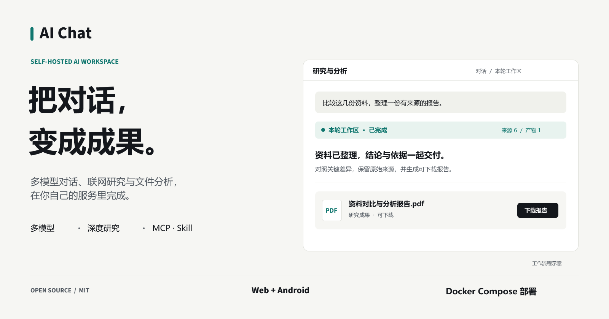

# AI Chat



**把多模型对话、联网研究、文件分析和工具执行，放进一个可自部署的工作台。**

AI Chat 面向个人自用和团队共享：接入自己的模型服务，在对话中搜索资料、阅读网页、分析文件、运行 Python，交付带来源的回答和可下载的成果。Web 端提供完整工作台与管理设置，Windows 和 macOS 客户端复用同一套界面，连接你部署的站点。

[在线体验](https://aichat.asheblog.org) · [快速部署](#快速部署) · [首次配置](#首次配置) · [完整部署指南](docs/DEPLOYMENT.md) · [桌面客户端](#桌面客户端)

## 能做什么

- **多模型，一个入口**：接入 OpenAI Chat Completions、OpenAI Responses、Anthropic Messages 和 Google Gemini。DeepSeek、GLM、Qwen 等可通过兼容协议接入，按模型能力调整推理强度。
- **从问题到研究报告**：搜索、读网页、确认研究计划、收集证据、导出 PDF。支持 Tavily、Brave、Exa、Metaso、DeepSeek 五种搜索引擎及多引擎并行。
- **分析自己的资料**：上传文件，在会话工作区处理；或建立 RAG 知识库，解析文档并在聊天时检索。
- **让模型完成操作**：在会话级 Docker 沙箱中执行 Python、读写文件、克隆 Git 仓库，管理运行资源、并发队列与下载产物。
- **按需扩展工具**：使用内置与第三方 Skill、远程 MCP、容器网关中的本地包 MCP；支持在聊天里通过 GitHub 链接安装扩展。
- **看懂回答怎样完成**：打开“本轮工作区”，按过程、来源、产物查看执行记录，筛选工具调用、检查错误与原始明细。聊天、分享与 Battle 共用 Web 工作区。
- **比较模型与回答**：Battle 支持多模型同题对比、单模型多题评测与题目配图；聊天重新生成后保留全部回答版本及历史用量。
- **管理共享服务**：用户与注册审批、访客额度、模型连接、密钥库、日志与任务追踪，以及品牌主题定制和统一的工具与扩展管理。

### 最近更新的使用体验

- **输入区以写作为主**：模型与推理强度使用同一入口；联网、研究、Python、知识库和扩展收进工具面板，已启用能力在输入区回显。
- **答案与过程各有位置**：正文保持阅读主位，按需展开本轮工作区；宽屏侧栏、手机全屏，来源和产物集中查看。
- **设置贴近实际运行**：连接、模型能力、生成参数和访问配置分别管理；搜索引擎的启用与排序合为一处，“工具与扩展”集中管理 MCP 服务、Skill、内置工具和对话增强。
- **偏好跟随账号**：个人提示词作为偏好层追加，会话上下文开关保存在账号中；关闭上下文时，消息仍保存，但历史消息不加入本次模型请求。

具体变更与升级说明见 [CHANGELOG](CHANGELOG.md)。

## 快速部署

推荐使用仓库自带的 **Docker Compose**。默认启动两个常驻容器：

- `app`：同容器运行 Next.js 前端、Hono 后端和文档处理 worker。
- `docker-socket-proxy`：供 Workspace 和本地包 MCP 创建隔离容器。

浏览器统一访问前端的 `/api`，默认对外端口为 **3000**，无需另行安装数据库。数据使用 SQLite 并写入 Docker 命名卷。

### 1. 准备主机与代码

安装 Git、支持 Linux 容器的 Docker 和 Docker Compose v2。Windows 使用 Docker Desktop 的 Linux 容器模式。建议从 **2 核 CPU、4 GB 内存**起步；同时运行多个 Python / MCP 容器或处理较大知识库时，按负载增加资源。

```bash
git clone https://github.com/Asheblog/Ai-Chat-web-UI.git
cd Ai-Chat-web-UI
cp .env.example .env
```

Windows PowerShell 将最后一行替换为 `Copy-Item .env.example .env`。

### 2. 修改环境配置

打开 `.env`，为下面三个变量分别填入独立生成的随机值：

- `JWT_SECRET`：签名登录令牌。
- `SECRET_VAULT_MASTER_KEY`：加密模型、MCP、Skill 等凭据；与数据一起备份，恢复时使用原值。
- `WORKSPACE_ARTIFACT_SIGNING_SECRET`：签名工作区产物的下载链接。

有 OpenSSL 时，可执行 `openssl rand -hex 32`，每次取一个新值。也可在已安装 Node.js 的机器上执行：

```bash
node -e "console.log(require('node:crypto').randomBytes(32).toString('hex'))"
```

使用本机或局域网 **HTTP** 访问时，在 `.env` 中加入：

```dotenv
COOKIE_SECURE=false
```

通过域名提供 **HTTPS** 服务时，使用 `COOKIE_SECURE=true`，由 Nginx、Caddy 或 1Panel 反代前端端口。同源部署将 `ENABLE_CORS` 设置为 `false`；只有前后端跨源访问时才启用 CORS 并配置 `CORS_ORIGIN`。

### 3. 拉取镜像并启动

```bash
docker compose pull
docker compose up -d
docker compose ps
docker compose logs -f app
```

首次启动会初始化数据库、同步内置 Skill，并准备受管 Python 运行环境。等待应用健康后访问：

- 页面：<http://localhost:3000>（远程部署时将 `localhost` 换成服务器地址）。
- 前端健康检查：<http://localhost:3000/api/health>。
- 后端健康检查：<http://localhost:3000/api/settings/health>。

前端端口被占用时，在 `.env` 设置 `FRONTEND_PORT=8080` 后重新执行 `docker compose up -d`，改用 8080 访问。

初始化账户、首次登录及模型接入见下节。资源配置、HTTPS、升级备份、分容器部署和故障排查见 [完整部署指南](docs/DEPLOYMENT.md)。

## 首次配置

### 1. 登录并完成初始化

默认新库由初始化脚本创建管理员：用户名 `admin`，初始密码 `admin123456`。登录后修改密码并完成初始化向导。自定义初始化账户的方法见 [部署指南](docs/DEPLOYMENT.md)；已有实例继续使用原账号与数据。

### 2. 接入第一个模型

管理员进入“系统设置 → 连接与模型”，添加供应商连接，填写服务地址和 API Key，再获取或配置模型列表。

| 你的服务 | 选择的协议 |
| --- | --- |
| OpenAI、DeepSeek、GLM、Qwen 等 Chat Completions 兼容服务 | OpenAI → Chat Completions |
| 提供 Responses API 的服务 | OpenAI → Responses |
| Anthropic 官方或兼容 Messages API 的服务 | Anthropic |
| Google Gemini API | Google Gemini |

回到聊天页，打开模型选择器，选择连接与模型，发送第一条消息。推理、图片和工具调用等能力取决于所选模型与供应商协议。

### 3. 按需开启研究、文件和扩展

| 想做的事 | 配置入口与前提 |
| --- | --- |
| 联网搜索 | “系统设置 → 搜索与知识库 → 联网搜索”配置引擎与对应 Key；然后在聊天工具面板开启联网。 |
| 用 DeepSeek 搜索 | 单独配置 DeepSeek 搜索 Key，聊天连接的 Key 不会自动用于搜索；Search / Fetch 按供应商计费。Fetch 回退默认关闭。 |
| 深度研究 | 先配置可用模型与搜索，聊天工具面板开启深度研究，按研究计划确认后继续执行。 |
| 分析文件、生成产物 | 在输入区添加文件并开启所需工具；Python 执行需要可用的 Docker 沙箱。 |
| 使用长期资料库 | “系统设置 → 搜索与知识库”配置知识库及检索能力，再从聊天工具面板选择知识库。 |
| 安装 MCP / Skill | “系统设置 → 工具与扩展”，或在聊天中给出 GitHub 链接。安装权限、连接密钥和容器前提见 [扩展使用指南](docs/EXTENSIONS.md)。 |

搜索、模型调用和远程扩展通过你配置的外部服务处理相应请求；服务端保存聊天与配置，Secret Vault 加密保存凭据。

## 源码开发

推荐 **Node.js 22 LTS（22.12+）**，使用 **pnpm 8.15.0**。需要执行 Workspace / 本地包 MCP 时，另备可用的 Docker。

在新克隆的仓库根目录执行：

```bash
pnpm install --frozen-lockfile
cp .env.example .env
# 按上文填写三项密钥；本地 HTTP 设置 COOKIE_SECURE=false
pnpm start:dev
```

Windows PowerShell 使用 `Copy-Item .env.example .env`。启动脚本负责检查依赖、同步 Prisma 数据库、执行种子初始化并启动开发服务。浏览器访问 <http://localhost:3000>；后端端口取决于本地环境配置。

源码环境的网页渲染与 PDF 导出需要可用的 Chromium / Chrome / Edge；文档处理还需 Python 运行环境。官方 Docker 镜像已包含这些依赖，本地配置方法见 [部署指南](docs/DEPLOYMENT.md)。

### 常用检查

```bash
pnpm --filter @aichat/backend test
pnpm --filter @aichat/frontend exec vitest run
pnpm --filter @aichat/backend type-check
pnpm --filter @aichat/frontend type-check
pnpm architecture:check
```

### 项目结构

```text
packages/
  frontend/    Next.js 15 · React 18 · Tailwind CSS · shadcn/ui
  backend/     Hono · Prisma · SQLite · 工具编排与文档 worker
  shared/      Web / 后端 / 移动端共享契约与纯函数
  desktop/     Electron · Windows / macOS 桌面客户端
  mobile/      React Native · Expo Android 客户端（暂停自动发布）
scripts/       本地启动、数据库初始化与检查脚本
docs/          部署、架构、设计与决策记录
```

## 桌面客户端

打开客户端，输入你部署的 **AI Chat 站点首页地址**（例如 `https://chat.example.com`，不带 `/api`），然后沿用站点账号登录。更换部署时，使用「服务器 → 更换服务器…」。

Windows x64 安装包为 `.exe`，Apple Silicon Mac 安装包为 `.dmg`。测试包从 [Desktop CI](https://github.com/Asheblog/Ai-Chat-web-UI/actions/workflows/desktop-ci.yml) 的构建产物下载，正式版发布到 [GitHub Releases](https://github.com/Asheblog/Ai-Chat-web-UI/releases)；两者当前都不做代码签名，安装时按系统提示放行即可（见 [ADR 0050](docs/adr/0050-desktop-release-ships-unsigned-artifacts.md)）。本地构建和发布配置见 [桌面客户端指南](packages/desktop/README.md)。

### Android 自动发布已暂停

现有 APK 和源码仍保留。需要安装历史版本或手工构建时，见 [Android 指南](packages/mobile/README.md)。

## 运维与进一步阅读

| 你要做什么 | 入口 |
| --- | --- |
| 部署、反代、备份、升级或排障 | [部署指南](docs/DEPLOYMENT.md) |
| 配置 AI 自助安装、MCP 与 Skill | [扩展使用指南](docs/EXTENSIONS.md) |
| 理解模块划分与请求链路 | [架构说明](docs/Architecture.md) |
| 查领域概念与规则 | [领域词汇表](GLOSSARY.md) |
| 查近期变化与迁移影响 | [变更日志](CHANGELOG.md) |
| 查架构决定与取舍 | [ADR](docs/adr/) |
| 修改 README 封面 | [Figma 设计稿](https://www.figma.com/design/g8OE79vEs53TGlcJ6Q4Cva?node-id=14-707) · [封面设计与源码](docs/design/readme-cover.md) |

反馈问题或建议请到 [GitHub Issues](https://github.com/Asheblog/Ai-Chat-web-UI/issues)，附上部署方式、复现步骤和脱敏日志。

## 许可证

本项目使用 [MIT License](LICENSE)。
