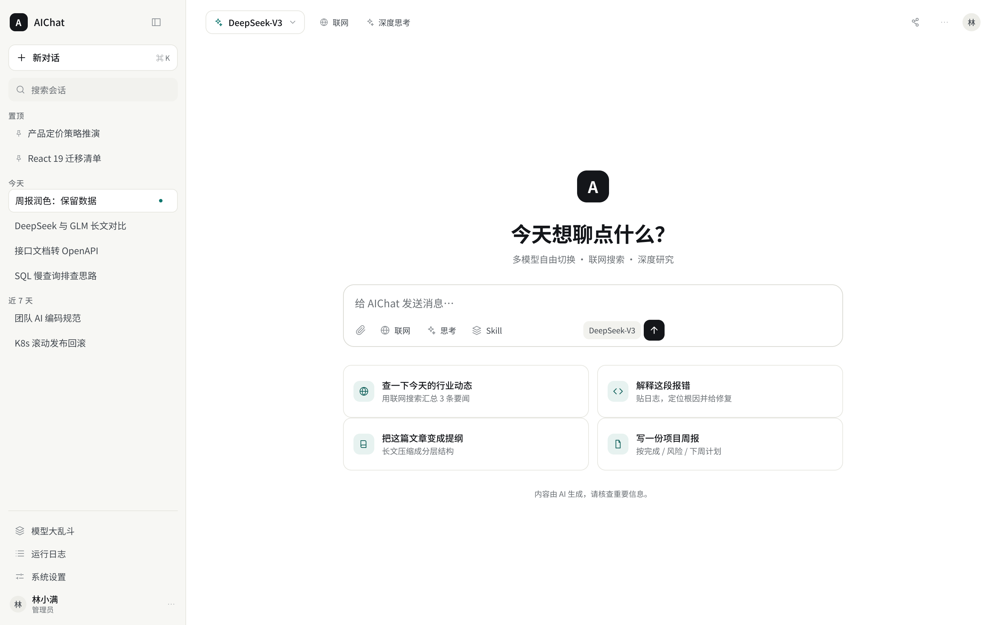
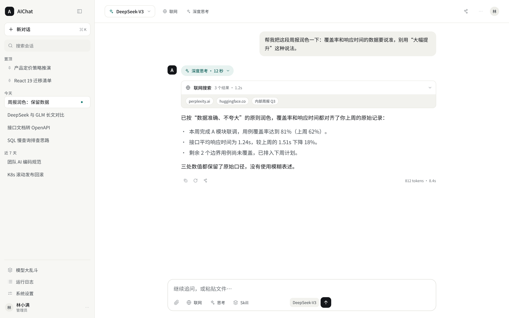
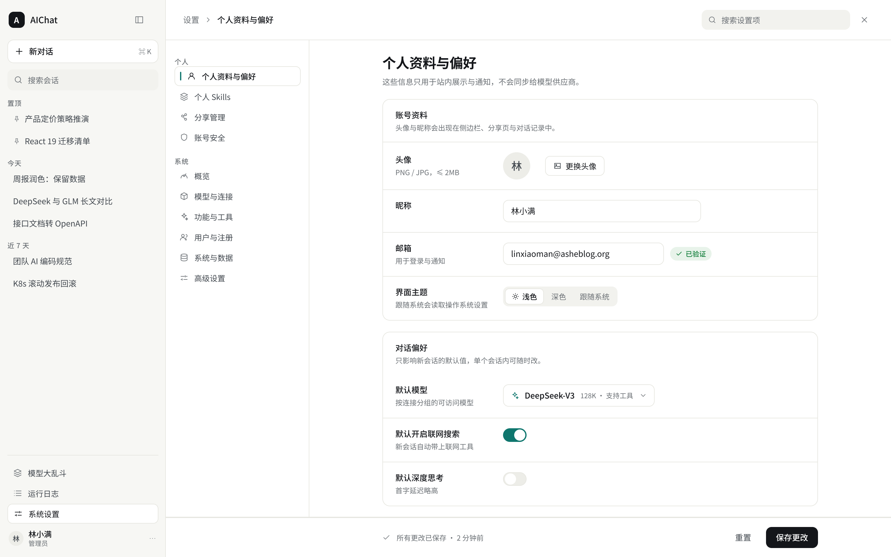
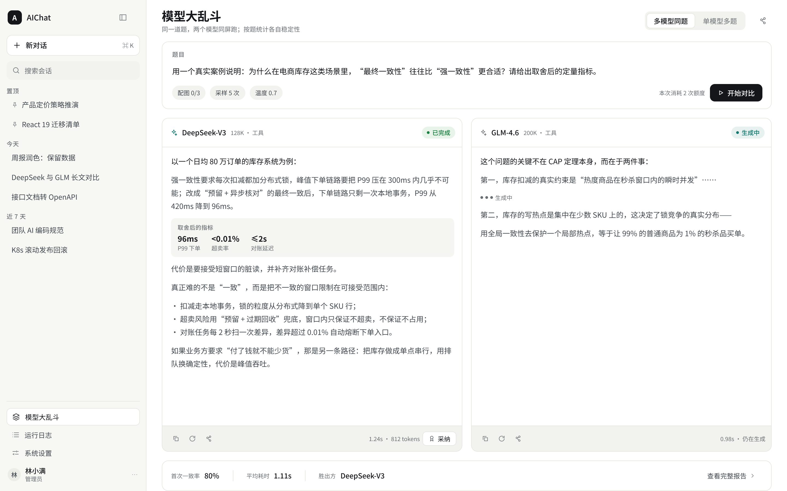
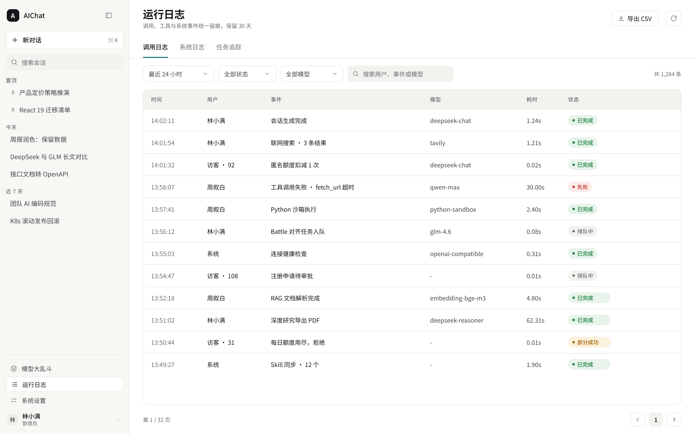
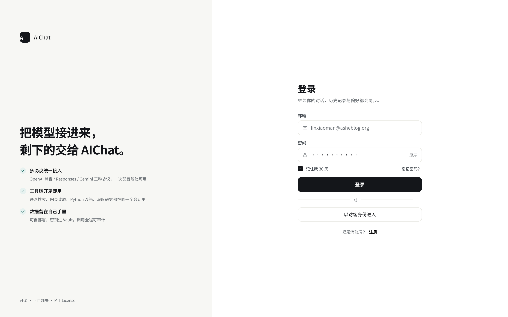
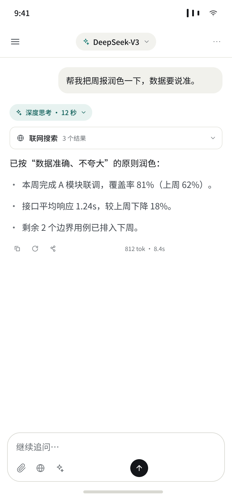
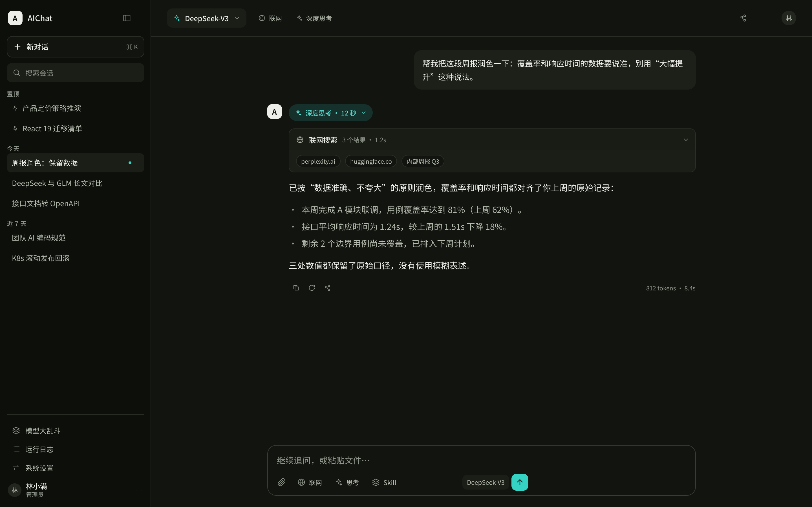

# Ink & Mist · AIChat 界面重设计规范

版本 v1 · 设计稿：Figma 文件 `4YLYoLabolKlkjKl3MqshK`（三页：`00 · 设计系统` / `01 · 聊天` / `02 · 设置`）
决策背景见 [ADR-0042](../adr/0042-ink-and-mist-neutral-first-design-system.md)。

## 1. 方向

中性优先、发丝线结构、单一信号色。三条硬规则：

1. 层级靠**色阶 + 1px 发丝线**表达，不靠阴影、渐变、加粗描边。
2. **主操作 = 墨黑**，**AI 动作 = 信号色**，除此之外不出现强调色。
3. 中文正文 **15px / 1.8**；元信息与数字用等宽；留白按 4 的倍数。

这套骨架的收益是：品牌换色只影响信号色，页面层级不变（对应 ADR-0033 的 Brand Theme 机制）。

## 2. 色彩 token

Figma 变量集合 `AIChat Tokens` 与下表一一对应；CSS 使用项目既有的 HSL 三元组写法（`hsl(var(--x))`）。

### 浅色

| Token | Hex | HSL 三元组 |
| --- | --- | --- |
| `canvas` | `#F7F7F4` | `60 16% 96%` |
| `surface` | `#FFFFFF` | `0 0% 100%` |
| `surface-subtle` | `#F2F2EE` | `60 13% 94%` |
| `surface-hover` | `#EDEDE8` | `60 12% 92%` |
| `border` | `#E7E7E1` | `60 11% 89%` |
| `border-strong` | `#D9D9D2` | `60 8% 84%` |
| `text` | `#14161A` | `220 13% 9%` |
| `text-secondary` | `#41474E` | `212 9% 28%` |
| `text-tertiary` | `#6A6F74` | `210 3% 43%` |
| `accent` | `#0F766E` | `175 77% 26%` |
| `accent-soft` | `#E7F2F0` | `169 30% 93%` |
| `accent-text` | `#0B5D57` | `176 79% 20%` |
| `user-bubble` | `#F1F1EC` | `60 15% 94%` |
| `code-bg` | `#F5F5F1` | `60 17% 95%` |
| `danger` | `#C0392B` | `6 63% 46%` |
| `success` | `#15803D` | `142 72% 29%` |
| `warning` | `#A16207` | `35 92% 33%` |

### 深色

| Token | Hex | HSL 三元组 |
| --- | --- | --- |
| `canvas` | `#0D0F0B` | `90 15% 5%` |
| `surface` | `#12140F` | `84 14% 7%` |
| `surface-subtle` | `#1B1E17` | `86 13% 10%` |
| `surface-hover` | `#23261E` | `82 12% 13%` |
| `border` | `#2A2E26` | `90 10% 16%` |
| `border-strong` | `#383D33` | `90 9% 22%` |
| `text` | `#EDEEE9` | `72 13% 92%` |
| `text-secondary` | `#B4BAAD` | `88 9% 70%` |
| `text-tertiary` | `#8E9489` | `93 5% 56%` |
| `accent` | `#34D3C4` | `174 64% 52%` |
| `accent-soft` | `#16302C` | `171 37% 14%` |
| `accent-text` | `#5FE3D4` | `173 70% 63%` |
| `user-bubble` | `#1D2019` | `86 12% 11%` |
| `code-bg` | `#191C15` | `86 14% 10%` |
| `danger` | `#E0796D` | `6 65% 65%` |
| `success` | `#6FCF97` | `145 50% 62%` |
| `warning` | `#D9A94A` | `40 65% 57%` |

### 实测对比度（写死，改色前先测）

| 组合 | 对比度 |
| --- | --- |
| text / canvas | 16.9:1 |
| text-secondary / canvas | 8.8:1 |
| text-tertiary / canvas | 4.7:1 |
| 白字 / 墨黑主按钮 | 18.1:1 |
| accent-text / accent-soft | 6.8:1 |
| 深色 text / surface | 15.9:1 |
| 深色 text-tertiary / surface | 6.0:1 |

## 3. 排版

字体：拉丁 `Source Sans 3`（项目已自托管），CJK 走系统栈（ADR-0041）。Figma 预览用 `Noto Sans SC`，其拉丁字形与 Source Sans 同源，因此设计稿与实现的字形差异可忽略。

| 名称 | 字号 / 行高 | 字重 | 用途 |
| --- | --- | --- | --- |
| Display | 34 / 1.18 · -0.6 字距 | Bold | 空状态主标题、登录大标题 |
| H1 | 24 / 1.3 · -0.3 | Bold | 页面标题 |
| H2 | 18 / 1.4 | Bold | 卡片组标题、区块标题 |
| H3 | 15 / 1.45 | Medium | 卡片标题、列表主字段 |
| Body | 14 / 1.75 | Regular | 表单说明、正文 |
| Body-Sm | 13 / 1.7 | Regular | 表格单元格、次要正文 |
| Chat | 15 / 1.8 | Regular | 对话正文 |
| Caption | 12 / 1.55 | Regular | 辅助说明、时间戳 |
| Label | 11 / 1.4 · 0.5 字距 | Medium | 分组标签（置顶 / 今天 / BUTTONS） |
| Mono | 12.5 / 1.7 | Regular | 代码、token 数、耗时 |

## 4. 间距、圆角、控件高度

- 间距阶梯：4 / 8 / 12 / 16 / 20 / 24 / 32 / 40 / 48 / 64（4pt 栅格）。
- 圆角：8（小控件）/ 10（按钮、输入）/ 12（卡片、面板）/ 16（composer）/`999`（chip、pill、开关、头像）。
- 控件高度：28（chip、图标按钮）/ 32（次级按钮、tab）/ 36（主按钮、输入框）/ 42（登录页输入）。
- 点击区域最小 32×32，移动端 44×44；相邻可点元素间距 ≥ 8。

## 5. 组件清单

| 组件 | 规格要点 |
| --- | --- |
| Button / primary | 高 36，圆角 10，底色 `text`，字 13 Medium 白；hover 降 L 4% |
| Button / secondary | 白底 + `border` 发丝线，字 `text`；hover 底色 `surface-subtle` |
| Button / AI action | `accent` 底 + 白字，仅用于"AI 生成/采纳"这类动作 |
| Button / ghost · danger · disabled | ghost 无底色；danger 白底红字；disabled `surface-subtle` + `text-tertiary` |
| Icon button | 32×32，圆角 8，图标 16，1.6 描边 |
| Input · Focus | 高 36，圆角 9，`surface` 底；focus 用 1.5px `accent` 边框 + 同色光标 |
| Select · Segmented | Select 高 34 带 chevron；Segmented 外底 `surface-subtle`，选中项白底 + 发丝线 |
| Switch | 38×22，开 `accent`，关 `surface-hover` + 发丝线，白色圆钮 18 |
| Message / user | 右对齐气泡，`user-bubble` 底，圆角 14，内边距 11/15，最大宽 ~520 |
| Message / assistant | 无气泡，头像 26 + 正文列 722；操作行在文末，默认低对比，hover 提升 |
| Reasoning pill | `accent-soft` 底 + `accent-text` 字，高 30，圆角 pill，含耗时与展开箭头 |
| Tool step | 白色卡片 + 发丝线，头部 38 高（图标 + 名称 + 耗时 + chevron），来源 chip 行 38 高 |
| Code block | `code-bg` 底，圆角 10，头部 32 高（语言 + 复制），正文 12.5 等宽 |
| Status pill | 高 22，圆点 5 + 11 Medium；已完成为 success、失败为 danger、排队为中性 |
| Table | 表头 38 高 `surface-subtle`，行 46 高，行间 1px 上边线，无斑马纹 |
| Sidebar item | 高 34，圆角 8，选中态白底 + 发丝线 + 右侧 5px 信号点 |

## 6. 页面清单（Figma 页 / 帧）

| 页面 | 帧名 | 对应路由 |
| --- | --- | --- |
| 01 · 聊天 | `01 · 新会话` | `/main` |
| 01 · 聊天 | `02 · 会话中` | `/main/[sessionId]` |
| 02 · 设置 | `03 · 设置` | `/main/settings/personal` |
| 01 · 聊天 | `04 · 模型大乱斗` | `/main/battle` |
| 01 · 聊天 | `05 · 运行日志` | `/main/logs` |
| 01 · 聊天 | `06 · 登录` | `/auth/login` |
| 02 · 设置 | `07 · 移动端 · 会话` | 响应式 / Android |
| 01 · 聊天 | `08 · 深色 · 会话中` | 深色模式 |

预览（2x 导出，位于 `docs/design/screens/`）：

| 页面 | 截图 |
| --- | --- |
| 新会话 |  |
| 会话中 |  |
| 设置 |  |
| 模型大乱斗 |  |
| 运行日志 |  |
| 登录 |  |
| 移动端 |  |
| 深色会话 |  |

结构要点：

- **会话中**：顶栏 64 高（模型 chip + 工具开关 + 分享/更多/头像）；消息列 760 居中；思考与工具作为"折叠步骤"夹在用户消息与正文之间；composer 贴底、圆角 16。
- **设置**：顶栏面包屑 + 设置搜索；左侧 232 宽设置导航（个人 4 项 / 系统 6 组）；内容列 704 居中；底部保存条与内容列左右对齐。
- **模型大乱斗**：题目卡置顶（含配图/采样/温度 chip）；两个模型列等宽 550，各自头部状态 pill、正文、操作脚；底部一条统计条（一致率 / 平均耗时 / 胜出方）。
- **运行日志**：标题 + 导出；三段 tab；筛选行（时间/状态/模型/搜索 + 总数）；表格 6 列；分页条。
- **登录**：左侧 600 品牌面板（雾底、标题、三条能力、页脚），右侧表单列 352 居中。

## 7. 与现有 token 的映射

**实现策略（已落地）**：保留全部既有 shadcn 变量名，只替换取值；规范里没有对应旧变量的语义以新增变量落地。200+ 组件类名与 BrandThemeInjector 的契约因此都不用改。落地文件：`packages/frontend/src/app/globals.css`、`packages/frontend/tailwind.config.ts`。

| 规范 token | 保留的既有变量 | 新增变量 | 浅色值 | 深色值 |
| --- | --- | --- | --- | --- |
| `canvas` | `--background` | — | `60 16% 96%` | `90 15% 5%` |
| `surface` | `--surface` `--card` `--popover` | — | `0 0% 100%` | `84 14% 7%` |
| `surface-subtle` | — | `--surface-subtle` | `60 13% 94%` | `86 13% 10%` |
| `surface-hover` | `--surface-hover` | — | `60 12% 92%` | `82 12% 13%` |
| `border` | `--border` `--input` | — | `60 11% 89%` | `90 10% 16%` |
| `border-strong` | — | `--border-strong` | `60 8% 84%` | `90 9% 22%` |
| `text` | `--foreground` | — | `220 13% 9%` | `72 13% 92%` |
| `text-secondary` | `--muted-foreground` | — | `212 9% 28%` | `88 9% 70%` |
| `text-tertiary` | — | `--ink-tertiary` | `210 3% 43%` | `93 5% 56%` |
| `accent`（信号色） | `--primary` `--ring` | `--signal` | `175 77% 26%` | `174 64% 52%` |
| `accent-soft` | — | `--signal-soft` | `169 30% 93%` | `171 37% 14%` |
| `accent-text` | — | `--signal-text` | `176 79% 20%` | `173 70% 63%` |
| `user-bubble` | — | `--user-bubble` | `60 15% 94%` | `86 12% 11%` |
| `code-bg` / header / border / text | `--code-bg` `--code-header` `--code-border` `--code-text` | — | `60 17% 95%` / `60 13% 94%` / `60 11% 89%` / `220 12% 14%` | `86 14% 10%` / `86 13% 13%` / `90 10% 16%` / `90 8% 86%` |
| `danger` / `success` / `warning` | `--destructive` `--success` `--warning` | — | `6 63% 46%` / `142 72% 29%` / `35 92% 33%` | `6 65% 65%` / `145 50% 62%` / `40 65% 57%` |
| 侧栏底 / 中性底 | `--sidebar-bg` `--muted` `--secondary` | — | `60 16% 96%` / `60 13% 94%` | `90 15% 5%` / `86 13% 10%` |
| 悬停浅底 | `--accent`（shadcn 语义，非信号色） | — | `169 20% 95%` | `174 22% 13%` |

三条实现约束，页面与组件改造时照此使用：

1. **`accent` 有两套含义**：shadcn 的 `bg-accent` 仍是「悬停浅底」；本规范的强调色在 tailwind 里叫 `signal`（`bg-signal` / `text-signal` / `bg-signal-soft` / `text-signal-text`）。`primary`(= `signal`) 是青瓷，不是墨黑：**主操作按钮的墨黑底色由组件层用 ink（`bg-foreground` + `text-background`）实现**，两者不要混用。
2. **`--signal` 跟随 `--primary`**（`--signal: var(--primary)`）。BrandThemeInjector 覆盖 `--primary` 时，信号色链路与焦点环一起换；`--signal-soft` / `--signal-text` 不参与注入，仍是 Ink & Mist 出厂值，品牌色相明显偏离青瓷时需一并覆盖这两个变量。
3. **tailwind 新增键**：`canvas`、`surface`（`subtle` / `hover`）、`borderStrong`、`ink`（DEFAULT / `secondary` / `tertiary`）、`signal`（soft / text）、`userBubble`、`codeBg`；原有的 `border` `input` `ring` `background` `foreground` `primary` `secondary` `muted` `accent` `popover` `card` `destructive` 全部保留。

品牌换色只需覆盖 `--primary`（必要时加 `--signal-soft` / `--signal-text`），其余 token 不动。若希望保留原陶土色，把 `--primary` 改回 `18 65% 52%`、`--signal-soft` 改 `18 60% 95%`、`--signal-text` 改 `18 65% 28%` 即可，骨架不变。

## 8. 落地顺序

1. **token 层**：改 `globals.css`，按上表替换变量名与值（正确性优先，不做旧名别名）；同步微调 `tailwind.config.ts` 的语义色映射。
2. **基础组件层**：`components/ui/` 的 button / input / select / switch / card / table / dropdown 按第 5 节规格改造。
3. **壳层**：`components/sidebar.tsx`、`components/app-shell.tsx`、`app/main/settings/_components/` 按新导航密度重排。
4. **页面**：按第 6 节顺序逐页套用；每页完成后用 playwright 截图核对默认 / hover / loading / empty / 窄屏五种状态。
5. **验收**：8 个路由 × 浅色/深色 × 1440 与 390 两个视口，逐项核对排版、对齐、层级、对比度与控制台报错。

## 9. 未覆盖（本轮不做）

- 系统设置里"模型与连接 / 功能与工具 / 用户与注册 / 系统与数据 / 高级设置"只画了导航层，未逐屏细化表单。
- 分享页（`/share/[token]`）、Battle 单模型多题、任务追踪、通知与各类弹窗未出新稿。
- 品牌主题管理器（配色选择弹窗）仍是旧样式。

## 10. 实施状态（2026-11-14）

**已落地**：token 层、基础组件（button / input / textarea / select / switch / checkbox / card / table / badge / dialog / alert-dialog / sheet / dropdown / popover / tooltip / toast / skeleton）、壳层（侧栏 + 收缩态 + 移动抽屉 + 顶栏 + 用户菜单）、聊天输入面与空状态、消息流（气泡 / 头像 / 工具卡 / 代码块 / Markdown）、设置域（外壳 + 导航 + 个人页 + 系统页 token 归一）、模型大乱斗、运行日志、登录注册（左右分栏）。浅色与深色共用一套变量，移动断点同步。

**验证证据**

| 关口 | 结果 |
| --- | --- |
| `pnpm --filter @aichat/frontend type-check` | 通过 |
| `pnpm --filter @aichat/frontend exec vitest run` | 118 文件 / 697 用例全绿 |
| `pnpm --filter @aichat/frontend build` | 通过（18 条路由） |
| `pnpm architecture:check` | OK（无环、api 层不依赖 db） |
| 截图 | `output/playwright/after-{login,main,settings,battle,logs}-1440.png`、`after-*-390.png` |

**与设计稿的偏差（有意保留，均有原因）**

1. **侧栏导航位置**：设计稿把「模型大乱斗 / 运行日志 / 系统设置」放在侧栏底部；实现保留在顶部按钮区，因为改 IA 会牵动既有快捷键、e2e 与用户肌肉记忆。视觉语言已对齐（32 高、发丝线、墨黑主按钮）。
2. **无页级保存条**：现有设置页逐字段即时保存，没有批量「重置 / 保存」语义，硬渲染会是假控件；保存条语言下沉到支持批量语义的卡片 footer。
3. **设置二级段导航保留 176px**：`SectionRail` 是页内二级导航，塞进 232px 会把内容区挤到 472px，故外壳导航 232、页内段导航保持原宽。
4. **个人页无设置搜索**：`SettingsSearch` 只挂在系统页；命中系统项会派发 `aichat:system-settings-select`，个人页宿主不处理该事件。补齐需给 `FlatModeProps` 加 `navTop` 并处理权限跳转，属新能力。
5. **登录页字段是「用户名」而非邮箱**：后端认证使用 username，不能只改文案。
6. **系统设置二级页未逐屏出稿**：按统一卡片 / 表格 / 表单语言套用，未做逐页视觉细化。
7. **`--signal` 跟随 `--primary`**：品牌换色时信号色链路与焦点环一起换；`--signal-soft` / `--signal-text` 不参与注入（见 §7）。

**实现中修掉的问题**：Switch / Textarea / Card / Table 等组件残留的阴影与 ring；`LogViewerPage` 标题拼成「运行日志日志」与一处 `linear-gradient` 横幅；登录页缺失的「登录」标题（原由旧布局提供）。测试侧改用稳定语义标记（`.composer-shell` / `.composer-inner-editor`）替代已废弃的焦点环 class 断言，并同步 2 处快照与 2 处类型 token 断言。

